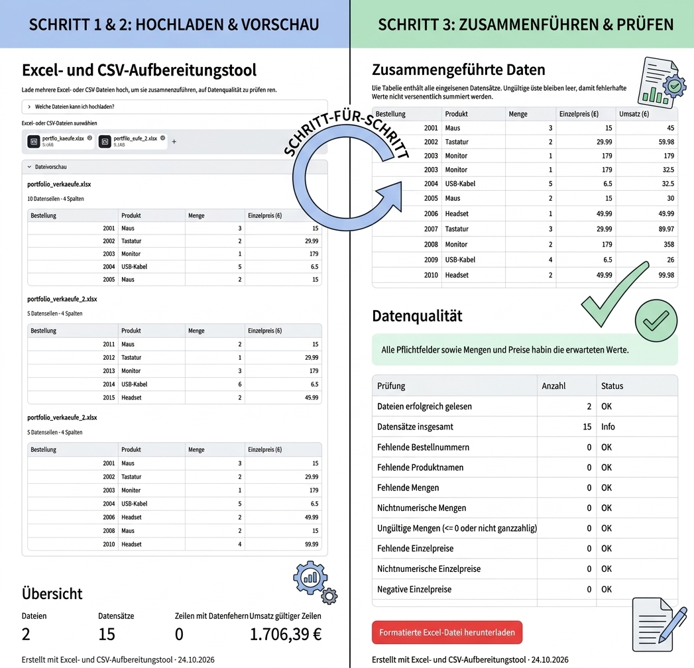
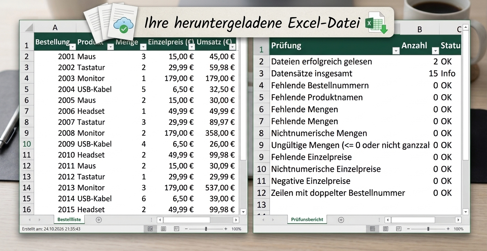

# Excel & CSV Data Processing Tool

A Python-based tool for cleaning, validating, combining, and analyzing Excel and CSV files. It helps reduce manual spreadsheet work and produces structured Excel reports.

## Features

- Import multiple Excel (`.xlsx`) and CSV (`.csv`) files
- Preview uploaded data before processing
- Validate required columns and data types
- Detect missing values and invalid quantities or prices
- Identify duplicate order numbers
- Calculate sales revenue
- Combine data from multiple files
- Generate data quality reports
- Export formatted Excel workbooks

## Two Ways to Use the Tool

### 1. Streamlit Web Application — `app.py`

The web application allows users to upload multiple Excel and CSV files through a browser.

**Workflow:**
1. Upload the files.
2. Preview the data.
3. Review validation results and data quality warnings.
4. Download the processed Excel workbook if no blocking data errors are found.

The application checks whether the uploaded files have compatible column names and order.

### 2. Automated Excel Processing — `main.py`

The standalone Python script processes two predefined Excel files and generates a sales report.

**Input files:**
- `beispieldaten/januar.xlsx`
- `beispieldaten/februar.xlsx`

**Output file:**
- `ergebnisse/auswertung.xlsx`

The generated workbook contains three worksheets:

- `Einzelverkaeufe` — combined sales data
- `Produktauswertung` — sales quantities and revenue grouped by product
- `Qualitaetsbericht` — data validation results

The script also applies Excel formatting, filters, frozen header rows, and currency formatting.

## Required Data Structure

Both programs use the following required columns:

| Column | Description |
|---|---|
| `Bestellung` | Order identifier |
| `Produkt` | Product name |
| `Menge` | Quantity sold |
| `Einzelpreis (€)` | Price per unit |

For reliable processing, uploaded files must use compatible column names and column order. Quantities must be positive whole numbers, and prices must be non-negative.

## Technologies

- Python
- Pandas
- OpenPyXL
- Streamlit

## Installation

Install Python, then install the dependencies:

```bash
pip install -r requirements.txt
```

## Run the Web Application

From the project directory, run:

```bash
python -m streamlit run app.py
```

The application will open in your browser.

## Run the Automated Script

Make sure the two input files exist in the `beispieldaten/` directory, then run:

```bash
python main.py
```

The report will be generated in the `ergebnisse/` directory.

The example input files are not included in this repository unless explicitly added.

## Screenshots

### Application Preview



### Excel Output



*If your screenshot filenames or extensions differ, update the paths above to match the actual files in the `screenshots/` directory.*

## Project Purpose

This project demonstrates practical Python skills in spreadsheet processing, data validation, reporting, and workflow automation. It was developed as a portfolio project using sales data.

